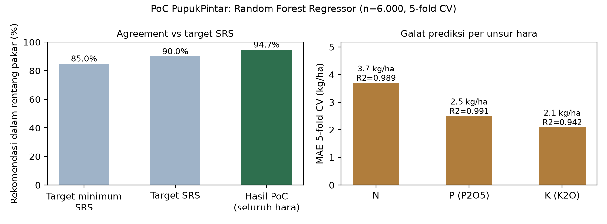

# PupukPintar - PoC AI Feasibility Check (LKP 6 PPKBP)

Repo publik **Kelompok 14** untuk Lembar Kerja Praktikum (LKP) 6 mata kuliah Perancangan Produk
Kecerdasan Buatan untuk Pertanian (PPKBP): *Wireframe, AI Feasibility Check & Blueprint Teknis*.

**Produk:** PupukPintar - Rekomendasi Dosis Pupuk Presisi per Lahan untuk Petani Padi dan Jagung
di Bogor dan Sekitarnya.

## Anggota Kelompok

| Nama | NIM |
|---|---|
| Irgi Setiawan | M0405241018 |
| Syarif Abdullah Assagaf | M0405241033 |
| Thogianna Anggitouli Metanoia Sinaga | M0405241077 |

## Isi Repo

| File | Keterangan |
|---|---|
| `run_poc.py` | Script proof-of-concept: penyusunan dataset proxy, pelatihan Random Forest, evaluasi, guardrail |
| `LKP6_PoC_PupukPintar.ipynb` | Notebook (siap diunggah ke Google Colab), sudah dieksekusi penuh beserta output |
| `hasil_poc.json` | Metrik hasil PoC dalam format JSON |
| `grafik_poc.png` | Grafik ringkasan hasil PoC (agreement vs target SRS, MAE per hara) |
| `wireframe/` | Tiga wireframe low-fidelity layar utama (entry point, fitur AI utama, hasil/output) |

## Apa yang Diuji PoC Ini

Membuktikan bahwa model regresi machine learning mampu memprediksi dosis pupuk N, P, K (kg/ha)
dari kondisi lahan (pH, N, P, K, tekstur, komoditas, target hasil, musim) **sebelum UI dibangun**,
sesuai rencana algoritma di LKP 4 (Random Forest / Gradient Boosting).

Dataset berupa 6.000 baris proxy yang dibangkitkan dari logika tabel rekomendasi resmi
(Permentan No. 40 Tahun 2007 dan kelas interpretasi kesuburan tanah Balittanah), sesuai strategi
labeling semi-automated di LKP 4. Data lapangan dari uji tanah petani akan menggantikan proxy ini
secara bertahap lewat kerja sama dengan poktan dan penyuluh.

## Hasil PoC (5-fold Cross-Validation, Random Forest Regressor)

| Aspek | Hasil | Target SRS (LKP 5) | Status |
|---|---|---|---|
| Agreement rentang pakar (deviasi maks. 12,5%) | **94,7%** (N 100%, P 98,6%, K 95,8%) | 85-90% | Terpenuhi |
| R2 per hara | N 0,989 / P 0,991 / K 0,942 | prioritas precision | Terpenuhi |
| MAE | N 3,7 / P 2,5 / K 2,1 kg/ha | - | - |
| Latensi 1 prediksi | sekitar 65 ms | < 5 detik | Terpenuhi |
| Keyakinan terkalibrasi | 0,93 pada contoh lahan umum | jujur, rendah saat meragukan | Terpenuhi |
| Deteksi di luar sebaran data latih | pH 9,4 tertangkap | arahkan ke uji lab / penyuluh | Terpenuhi |

Catatan jujur: angka tinggi di atas diperoleh pada data proxy dari tabel resmi, bukan data
lapangan. PoC membuktikan alur teknisnya (input hara -> model -> dosis dalam rentang aman);
akurasi pada kondisi lapangan divalidasi setelah data petani terkumpul.



## Cara Menjalankan

```bash
pip install pandas numpy scikit-learn matplotlib
python run_poc.py
```

Atau buka `LKP6_PoC_PupukPintar.ipynb` di [Google Colab](https://colab.research.google.com/) dan
jalankan semua sel.

## Tautan Terkait

- Wireframe Figma: https://www.figma.com/design/rSkPUlILq9yMteqXRwDBHF/PupukPintar?node-id=0-1
- Tech stack yang disepakati (LKP 6): Flutter (frontend), FastAPI (backend/API), Random Forest
  diekspor joblib (model), PostgreSQL/SQLite (database).
